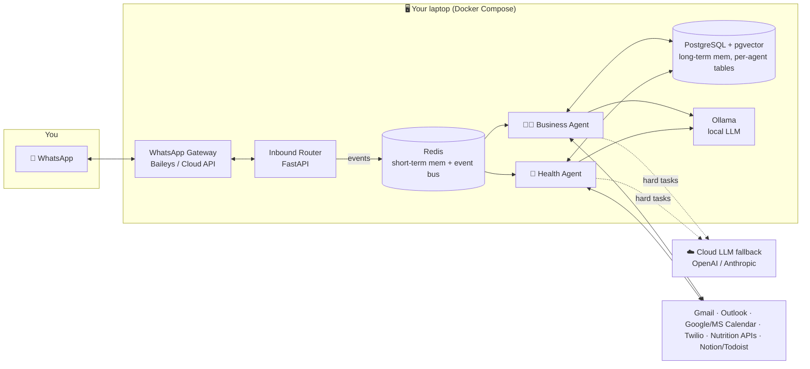

# AIA — Local Multi-Agent Personal Assistant

> Two independent AI agents — a **Business Assistant** and a **Health & Diet Coach** — that run
> **locally on your laptop** and talk to you through **WhatsApp**. Hybrid LLM (local Ollama by
> default, cloud fallback for hard tasks). Multi-tenant-ready, OAuth-based, no plaintext secrets.

<p align="center"><em>Describe what you want in WhatsApp → the agents act on your real email, calendar, tasks, calls, meals and workouts → you get proactive updates back.</em></p>

---

## Why this design

| Decision | Choice | Why |
|---|---|---|
| **Where it runs** | Your laptop (Docker Compose) | No cloud bill, data stays local, works on Win/macOS/Linux |
| **LLM** | **Hybrid** — local [Ollama](https://ollama.com) default, cloud (GPT‑4o/Claude) fallback | Private & free for routine work; quality on demand |
| **Interface** | **WhatsApp** | Everyone already has it; supports proactive push |
| **WhatsApp transport** | **Baileys (QR pairing)** by default; **Meta Cloud API** adapter for compliance | QR scan = truly non‑technical onboarding. See the trade‑offs in [docs/05](docs/05-integrations.md) |
| **Agent isolation** | Separate memory, prompts, tools, tables, config per agent | Requirement #1 — fully independent agents on shared infra |
| **Secrets** | Fernet envelope encryption + OS keychain master key | No credential ever stored in plaintext |

> ⚠️ **WhatsApp honesty note.** The default Baileys transport is an *unofficial* WhatsApp Web
> client. It is the easiest path for a personal install (scan a QR like WhatsApp Web), but it is
> **against WhatsApp's Terms of Service** and a number *can* be banned. Use a **secondary number**,
> or switch `WHATSAPP_PROVIDER=cloud` to use Meta's official Business Cloud API. Both sit behind one
> interface — no code changes to switch.

---

## Architecture at a glance



Full diagrams and component contracts: **[docs/01-architecture.md](docs/01-architecture.md)**.

---

## Quick start (≈10 minutes)

**Prerequisites:** [Docker Desktop](https://www.docker.com/products/docker-desktop/) (or Docker
Engine + Compose v2). 16 GB RAM recommended for the local model. Nothing else.

```bash
# 1. Clone & enter
git clone <your-fork-url> aia && cd aia

# 2. One-command first run: builds images, pulls the local model, runs migrations
make setup

# 3. Launch the setup wizard and connect your accounts (Email, Calendar, WhatsApp…)
make onboard           # opens http://localhost:8088

# 4. Start both agents + the gateway
make up

# 5. Watch it work
make logs
```

On **Windows** without `make`, run `./scripts/install.ps1` (PowerShell). On macOS/Linux
`./scripts/install.sh` does the same as `make setup && make onboard`.

The wizard walks a non-technical user through: create master key → connect Google/Microsoft via
OAuth → scan the WhatsApp QR → pick nutrition provider → set preferences → **Launch agents**.

---

## What each agent does

### 🧑‍💼 Agent 1 — Business Assistant
Reads/triages/drafts **email**, manages **calendar** (availability, scheduling, reschedules),
tracks **tasks & follow-ups**, handles **inbound/outbound phone calls** (Twilio + voice),
keeps a **CRM-like memory** of clients, and **escalates** what matters — all surfaced over WhatsApp
with daily summaries.

> *Client:* "Can we reschedule tomorrow's meeting?" → agent checks calendar → proposes free slots →
> updates the event → confirms to both parties → logs it to the client's CRM record.

### 🥗 Agent 2 — Health & Diet Coach
Logs **meals** (natural language → calories + macros), tracks **weight** and **exercise**,
computes **TDEE** and calorie targets, spots unhealthy trends, and sends **daily accountability**
and weekly progress reports over WhatsApp.

> *You:* "I had 2 eggs, toast and tea for breakfast." → agent estimates ~320 kcal / 18 g protein →
> updates today's log → "612 kcal left today, you're 8 g ahead on protein 💪".

Prompts and the full tool catalog: **[docs/04-agent-prompts-and-tools.md](docs/04-agent-prompts-and-tools.md)**.

---

## Repository layout

```
ai-assistant-system/
├─ src/aia/                  # the shared `aia` package (one install, many entrypoints)
│  ├─ config.py              # typed settings (pydantic-settings)
│  ├─ db/                    # SQLAlchemy models + engine (per-agent schemas)
│  ├─ security/              # Fernet crypto, keychain master key, audit log
│  ├─ llm/router.py          # hybrid local→cloud routing (LiteLLM)
│  ├─ memory/                # short_term (Redis) + long_term (pgvector)
│  ├─ events/bus.py          # Redis Streams event bus
│  ├─ agents/
│  │  ├─ base.py, tools.py   # BaseAgent + tool framework (LangGraph)
│  │  ├─ business/           # Agent 1: prompts, tools, workflow, service
│  │  └─ health/             # Agent 2: prompts, tools, nutrition math, service
│  ├─ integrations/          # whatsapp · email · calendar · tasks · voice · nutrition
│  ├─ gateway/               # inbound router (WhatsApp/webhooks → events → agents)
│  └─ onboarding/            # local setup wizard (FastAPI + Jinja)
├─ services/whatsapp-gateway # Node sidecar (Baileys + Cloud API)
├─ deploy/ docker/ scripts/  # init SQL, Dockerfiles, install scripts
├─ docs/                     # the full design specification (start at 01)
└─ tests/
```

Why one `aia` package instead of microservice repos? **Simplicity & maintainability** (the stated
top priorities): shared models/contracts live in one place; each container just runs a different
`python -m aia.<entrypoint>`. It still scales out — see [docs/08](docs/08-hardware-cost-scalability.md).

---

## Documentation map

| # | Doc | Covers |
|---|---|---|
| 01 | [Architecture](docs/01-architecture.md) | Layers, data flow, event-driven workflows, agent isolation |
| 02 | [Tech stack](docs/02-tech-stack.md) | Every dependency and the reasoning |
| 03 | [Database schema](docs/03-database-schema.md) | Tables, pgvector memory, multi-tenant scoping |
| 04 | [Agent prompts & tools](docs/04-agent-prompts-and-tools.md) | System prompts + tool definitions for both agents |
| 05 | [Integrations](docs/05-integrations.md) | WhatsApp / Email / Calendar / Phone / Tasks / Nutrition |
| 06 | [Deployment & onboarding](docs/06-deployment-and-onboarding.md) | Docker, install scripts, the setup wizard flow |
| 07 | [Security](docs/07-security.md) | OAuth2, token encryption, isolation, audit logs |
| 08 | [Hardware, cost & scalability](docs/08-hardware-cost-scalability.md) | Specs, local vs cloud cost, scale-out path |
| 09 | [Roadmap](docs/09-roadmap.md) | Phased path from scaffold → production |

---

## Project status

This is a **runnable, coherent scaffold**: the infrastructure layer, agent framework, schema,
provider abstractions, Docker stack and onboarding wizard are real and wired together. Individual
integration calls and some tools are marked `# TODO(impl)` with the exact contract to fill in — see
the [roadmap](docs/09-roadmap.md). It is intentionally a foundation you can ship on, not a finished
SaaS.

## License
MIT — see [LICENSE](LICENSE).
