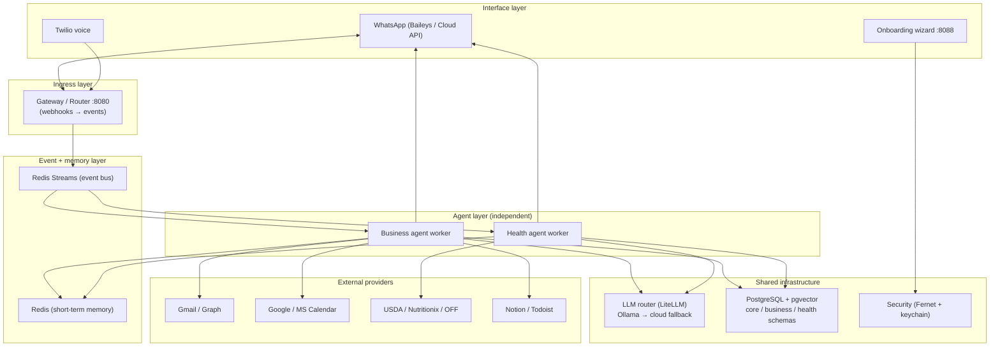

# 01 · System Architecture

## 1.1 Design goals (in priority order)

1. **Simplicity & maintainability** — one installable package, one `docker compose up`.
2. **Local-first & private** — runs entirely on a laptop; cloud is optional.
3. **Two fully independent agents** — separate prompts, tools, memory, tables, config.
4. **WhatsApp-native** — both reactive replies and proactive pushes.
5. **Multi-tenant-ready** — single user per laptop today, hosted multi-user later, no rewrite.

## 1.2 Layered view



| Layer | Responsibility | Code |
|---|---|---|
| Interface | Talk to the human/clients (WhatsApp, voice) + setup | `services/whatsapp-gateway`, `aia.onboarding` |
| Ingress | Normalise webhooks → events, **route to one agent** | `aia.gateway` |
| Event + memory | Decouple ingest from reasoning; durable delivery; context | `aia.events`, `aia.memory.short_term` |
| Agent | Reason, call tools, reply, escalate | `aia.agents.business`, `aia.agents.health` |
| Infrastructure | LLM, persistence, secrets — shared, not agent-specific | `aia.llm`, `aia.db`, `aia.security`, `aia.memory.long_term` |
| Providers | OAuth-scoped access to the user's real accounts | `aia.integrations.*` |

## 1.3 Why event-driven

Every external trigger becomes an **event** on Redis Streams; agents are **consumers** in
named groups. Benefits:

- **Decoupling** — the gateway only ingests; agents only reason. Either can restart independently.
- **Durability & retries** — consumer groups give at-least-once delivery; an unacked event is redelivered.
- **Backpressure** — bursts (e.g. an inbox sync) queue instead of overwhelming the LLM.
- **Extensibility** — a new surface (Telegram, a mobile widget) just publishes the same events.

Streams: `whatsapp.inbound.<agent>`, `email.received`, `calendar.changed`, `phone.inbound`,
`health.update`, `agent.outbound`.

## 1.4 Agent independence (Requirement #1)

| Dimension | How it's isolated |
|---|---|
| Prompts | `agents/business/prompts.py` vs `agents/health/prompts.py` |
| Tools | Separate `ToolRegistry` instances; no shared tools |
| Memory | Short-term keys namespaced `aia:{tenant}:{agent}:…`; long-term rows filtered by `agent` |
| Database | Separate Postgres **schemas** `business.*` / `health.*`; no cross-schema FKs |
| Workflow | Separate worker processes + consumer groups |
| Config | Same `Settings`, but each agent reads only the keys it needs |

They **share** only the infrastructure layer (LLM router, DB engine, crypto, event bus) — by design, for maintainability.

## 1.5 Key sequences

**Reschedule a meeting (Business):**

```mermaid
sequenceDiagram
  participant Client
  participant WA as WhatsApp sidecar
  participant GW as Gateway
  participant Bus as Redis Streams
  participant BA as Business agent
  participant Cal as Google Calendar
  Client->>WA: "Move tomorrow's 2pm?"
  WA->>GW: POST /webhook/whatsapp
  GW->>Bus: publish whatsapp.inbound.business
  Bus->>BA: deliver event
  BA->>Cal: free_slots(tomorrow..+3d, 30m)
  Cal-->>BA: [Thu 11:00, Fri 15:30]
  BA->>WA: "I can do Thu 11 or Fri 15:30 — which?"
  Client->>WA: "Thu 11"
  WA->>GW->>Bus->>BA: (routed again)
  BA->>Cal: update_event(new time)
  BA->>WA: "Done ✅ moved to Thu 11:00"
```

**Log a meal (Health):**

```mermaid
sequenceDiagram
  participant User
  participant WA
  participant GW as Gateway (route→health)
  participant HA as Health agent
  participant NUT as Nutrition API
  User->>WA: "2 eggs, toast and tea"
  WA->>GW->>HA: whatsapp.inbound.health
  HA->>NUT: lookup("2 eggs, toast and tea")
  NUT-->>HA: ~320 kcal / 18g protein
  HA->>HA: write meals row, recompute remaining
  HA->>WA: "Logged ~320 kcal. 1,480 left today 💪"
```

## 1.6 Process & port map

| Process | Port | Role |
|---|---|---|
| `whatsapp-gateway` (Node) | 8085 | Baileys socket + REST bridge |
| `gateway` (FastAPI) | 8080 | webhooks → events, routing |
| `business-agent` | — | consumer worker |
| `health-agent` | — | consumer worker |
| `onboarding` | 8088 | setup wizard |
| `postgres` | 5432 | data + vectors |
| `redis` | 6378 | bus + short-term memory |
| native Ollama | 11434 | local LLM running on the host |

See [06-deployment-and-onboarding.md](06-deployment-and-onboarding.md) for the runtime topology.
