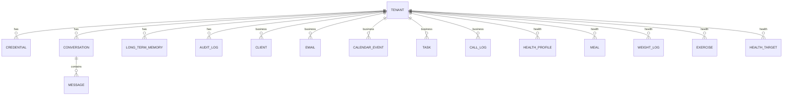

# 03 · Database Schema

PostgreSQL 16 + pgvector. Three schemas enforce agent isolation; every row carries a
`tenant_id` for multi-tenancy. Source of truth: [`src/aia/db/models.py`](../src/aia/db/models.py).

## 3.1 Schema map



## 3.2 `core` schema (shared infra)

| Table | Key columns | Notes |
|---|---|---|
| `tenants` | id, name, timezone, preferences (JSON) | one row per user (per laptop = 1) |
| `credentials` | provider, account_label, **encrypted_blob**, scopes, expires_at | OAuth tokens, **always** envelope-encrypted |
| `conversations` | agent, channel, peer | one per (agent, contact) |
| `messages` | conversation_id→, role, content, meta | full transcript history |
| `long_term_memory` | agent, kind, content, **embedding vector(768)**, meta | semantic recall, namespaced by agent |
| `audit_logs` | agent, action, resource, meta | append-only "what did the agent do" |

## 3.3 `business` schema (Agent 1 / CRM)

| Table | Key columns | Purpose |
|---|---|---|
| `clients` | name, phone, email, company, notes, preferences | CRM profile |
| `emails` | provider, external_id, sender, subject, category, urgency, summary, status | triage state |
| `calendar_events` | provider, external_id, title, starts_at, ends_at, attendees, status | mirrored events |
| `tasks` | title, status, due_at, source, client_id | follow-ups & deadlines |
| `call_logs` | direction, peer, duration_sec, transcript, summary, escalated | phone history |

## 3.4 `health` schema (Agent 2)

| Table | Key columns | Purpose |
|---|---|---|
| `health_profile` | sex, age, height_cm, weight_kg, activity_level, goal, target_weight_kg, target_calories | basis for TDEE/targets |
| `meals` | logged_at, description, calories, protein_g, carbs_g, fat_g, source | nutrition log |
| `weight_logs` | logged_at, weight_kg | trend analysis |
| `exercises` | logged_at, kind, duration_min, calories_burned | activity log |
| `targets` | day, calorie_target, protein_target_g | per-day goals |

## 3.5 Memory model

- **Short-term** (Redis): rolling 20-turn window per `(tenant, agent, peer)`, TTL 7 days. Feeds the prompt.
- **Long-term** (pgvector): durable facts/preferences/summaries. Retrieved by cosine similarity, filtered by `(tenant_id, agent)` so agents never read each other's memory.

```sql
-- recall (conceptually) — note the agent + tenant filter that enforces isolation
SELECT content
FROM core.long_term_memory
WHERE tenant_id = :tenant AND agent = :agent
ORDER BY embedding <=> :query_embedding
LIMIT 5;
```

A recommended ANN index for scale: `CREATE INDEX ON core.long_term_memory USING hnsw (embedding vector_cosine_ops);`

## 3.6 Multi-tenancy

Single-laptop installs use `tenant_id = "default"`. The identical schema supports a hosted
deployment by populating `tenant_id` per user and adding a **row-level security** policy:

```sql
ALTER TABLE core.long_term_memory ENABLE ROW LEVEL SECURITY;
CREATE POLICY tenant_isolation ON core.long_term_memory
  USING (tenant_id = current_setting('aia.tenant_id', true));
```

No application code changes — see [08-hardware-cost-scalability.md](08-hardware-cost-scalability.md).

## 3.7 Bootstrap vs migrations

First run uses the idempotent [`aia.db.init`](../src/aia/db/init.py) (creates extension + schemas +
tables). For evolving production schemas, switch to Alembic (already a dependency): generate a
baseline then `alembic revision --autogenerate` thereafter.
