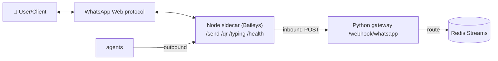
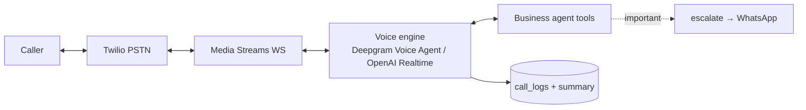

# 05 · Integration Architecture

Every integration sits behind a **provider interface** so a user can swap implementations without
touching agent code. Concrete adapter chosen by a `get_*_provider()` factory reading `.env`.

```
agent ──> interface (ABC) ──> adapter A | adapter B ──> external API
                                  ▲
                          chosen via Settings
```

## 5.1 WhatsApp — the recommendation

**You asked me to recommend.** For non-technical users connecting their **own** WhatsApp, the
honest answer is a two-adapter design, defaulting to QR pairing:

| | **Baileys (default)** | **Meta Cloud API** |
|---|---|---|
| Onboarding | **Scan a QR** (like WhatsApp Web) — 30s, no accounts | Meta Business acct, number registration, app review |
| Cost | Free | Per-conversation pricing (free tier, then ~$0.005–0.08) |
| Proactive msgs | **Anytime** | Only via approved **templates** outside 24h window |
| Compliance | **Unofficial — against WhatsApp ToS, ban risk** | Official, compliant |
| Reliability | Can break on WhatsApp updates | Stable, SLA-backed |
| Best for | Personal use, the Health coach, quick start | Client-facing Business agent at scale |

**Recommendation:** ship **Baileys as the default** (truly non-technical, supports proactive
pushes), with a **prominent warning** to use a *secondary number*, and provide the **Cloud API
adapter** as a one-line switch (`WHATSAPP_PROVIDER=cloud`) for anyone who needs compliance — ideal
for the Business agent talking to real clients. Both implement the same `WhatsAppProvider`
interface, so switching never touches agent logic.

**Topology (Baileys):**



Code: [`integrations/whatsapp/`](../src/aia/integrations/whatsapp/) (`base.py`, `baileys.py`,
`cloud_api.py`) + the sidecar [`services/whatsapp-gateway`](../services/whatsapp-gateway).

## 5.2 Email (Gmail / Microsoft Graph)

Interface `EmailProvider`: `list_recent`, `get_body`, `send`, `create_draft`. The **agent's LLM**
does categorisation/urgency/summary — the provider just moves bytes.

- **Gmail**: REST + Bearer token, MIME built locally, base64url. [`email/gmail.py`](../src/aia/integrations/email/gmail.py)
- **Outlook/M365**: Microsoft Graph `/me/messages`, `/sendMail`. [`email/graph.py`](../src/aia/integrations/email/graph.py)

A poller (cron/APScheduler) calls `list_recent`, diffs against the `emails` table, and publishes
`email.received` for genuinely new mail; the Business agent triages and escalates if urgent.

## 5.3 Calendar (Google / Microsoft)

Interface `CalendarProvider`: `list_events`, `free_slots`, `create_event`, `update_event`,
`cancel_event`. `free_slots` (freeBusy → gap-finding) powers the reschedule flow.
Code: [`calendar/google.py`](../src/aia/integrations/calendar/google.py).

## 5.4 Phone / voice (Twilio + realtime engine)



`inbound_twiml` bridges call audio to the engine; transcripts + summaries are stored and important
calls escalate. Code: [`voice/twilio_provider.py`](../src/aia/integrations/voice/twilio_provider.py).

## 5.5 Tasks (local / Notion / Todoist / Google Tasks)

Interface `TaskProvider`: `add`, `list_open`, `complete`. **Local DB is the default** so the system
is fully functional with zero external setup; cloud task managers are drop-in adapters.
Code: [`tasks/`](../src/aia/integrations/tasks/).

## 5.6 Nutrition (USDA / Nutritionix / OpenFoodFacts)

Interface `NutritionProvider.lookup(query) -> NutritionInfo`. If no provider/key is configured the
Health agent falls back to an **LLM macro estimate**, so meal logging always works.

| Provider | Strength | Key |
|---|---|---|
| USDA FoodData Central (default) | Free, authoritative whole foods | free API key |
| Nutritionix | Natural-language ("2 eggs and toast") parsing | app id + key |
| OpenFoodFacts | Packaged/barcode products | none |

Code: [`nutrition/`](../src/aia/integrations/nutrition/).

## 5.7 Credentials & OAuth

All provider tokens are obtained via OAuth 2.0 in the onboarding wizard and stored **encrypted**
(see [07-security.md](07-security.md)). Generic flow: [`integrations/oauth.py`](../src/aia/integrations/oauth.py).
Adding a provider = one `ProviderCfg` entry (auth/token URLs + scopes) + an adapter.
