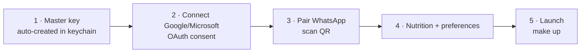

# 06 · Deployment & Onboarding

## 6.1 One-command deploy

```bash
make setup     # build images, start postgres/redis/ollama, pull models, init DB
make onboard   # launch wizard at http://localhost:8088
make up        # start gateway + both agents
```

`scripts/install.sh` (macOS/Linux) and `scripts/install.ps1` (Windows) wrap `setup`+`onboard` for
users without `make`. Everything is **Docker Compose** ([`docker-compose.yml`](../docker-compose.yml)).

## 6.2 Services

| Service | Image | Notes |
|---|---|---|
| postgres | `pgvector/pgvector:pg16` | `init.sql` enables vector + schemas |
| redis | `redis:7-alpine` | append-only persistence |
| ollama | `ollama/ollama` | local LLM; GPU optional |
| whatsapp-gateway | Node 20 (Baileys) | QR session persisted in a volume |
| gateway | python.Dockerfile | webhooks → events |
| business-agent / health-agent | python.Dockerfile | worker processes |
| onboarding | onboarding.Dockerfile | setup wizard |

Persistent volumes: `pgdata`, `redisdata`, `ollama_models`, `wa_auth`. `make clean` removes them.

## 6.3 GPU / acceleration

| OS | Recommendation |
|---|---|
| **macOS (Apple Silicon)** | Run **Ollama natively** (`brew install ollama`) for Metal GPU; point `OLLAMA_BASE_URL` at `http://host.docker.internal:11434`. Docker on Mac can't pass the GPU. |
| **Linux + NVIDIA** | Install NVIDIA Container Toolkit, uncomment the `deploy.resources` GPU block in compose. |
| **Windows + NVIDIA** | Docker Desktop + WSL2 GPU passthrough, or run Ollama natively on Windows. |
| **CPU-only** | Works with 7–8B Q4 models; expect 5–20 tok/s. Use cloud fallback for hard tasks. |

## 6.4 Onboarding wizard flow



- **Server-side OAuth**: the browser is redirected to the provider; the wizard exchanges the code and stores encrypted tokens. The browser never sees a token. ([`onboarding/main.py`](../src/aia/onboarding/main.py))
- **WhatsApp QR**: fetched from the sidecar `/qr` (data-URL PNG) and shown until paired.
- **Redirect URI**: set each OAuth app's redirect to `${PUBLIC_BASE_URL}/oauth/callback` (default `http://localhost:8088/oauth/callback`).

## 6.5 What a non-technical user must do

1. Install Docker Desktop (one download).
2. Run the installer script (double-click / one command).
3. In the browser wizard: click **Connect Google**, sign in; **scan the WhatsApp QR**.
4. Message their own WhatsApp number. Done.

The only technical prerequisite is Docker. Creating the Google/Microsoft OAuth *app* (client id/secret)
is a one-time admin step documented in the wizard; for a managed distribution you can ship a hosted
OAuth proxy so users skip it entirely (see [08](08-hardware-cost-scalability.md), §scale-out).

## 6.6 Configuration

All config is environment variables ([`.env.example`](../.env.example)) — no hardcoded secrets.
The wizard writes connected-account state to the encrypted `credentials` table; `.env` holds only
non-secret defaults and the OAuth **client** app credentials.
