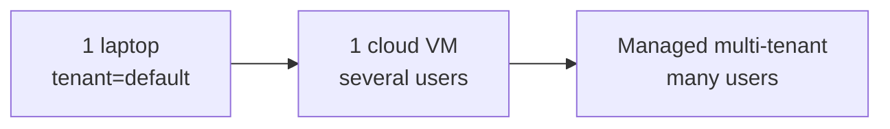

# 08 · Hardware, Cost & Scalability

## 8.1 Estimated hardware (local install)

The driver is the **local LLM**. Everything else (Postgres, Redis, two Python workers, Node sidecar)
is light — together ~1.5–2 GB RAM and negligible CPU at personal volume.

| Tier | Spec | Local model | Experience |
|---|---|---|---|
| **Minimum** | 8 GB RAM, 4 cores, no GPU | 3–4B Q4 (e.g. `llama3.2:3b`) | Works; slower, simpler reasoning. Lean on cloud fallback. |
| **Recommended** | 16 GB RAM, 6–8 cores, or Apple Silicon M1/M2 | **8B Q4** (`llama3.1:8b`) | Smooth for both agents; the default. |
| **Comfortable** | 32 GB RAM + 8 GB GPU (or M3/M4) | 8B fp16 / 14B Q4 | Fast, higher-quality local reasoning; rare cloud use. |
| **Power** | 32–64 GB + 16–24 GB GPU | 14–32B | Near-cloud quality fully local. |

Disk: ~5 GB images + ~5 GB per local model + data growth. Budget **15–20 GB**.
A 7–8B Q4 model needs ~5–6 GB RAM while loaded; embeddings model ~0.5 GB.

## 8.2 Cost — local vs cloud

### Fully local (default, cloud disabled)
**Marginal cost ≈ $0.** Electricity only. No per-message or per-token fees. One-time: the user's
existing laptop. This is the headline benefit.

### Hybrid (local default + cloud fallback for hard tasks)
You only pay for the slice of requests routed to the cloud (`complexity="hard"` or local failure).

| Assumption | Value |
|---|---|
| Messages/day (one user, both agents) | ~60 |
| Share escalated to cloud | ~20% → ~12/day |
| Tokens per cloud call (in+out) | ~1.5K |
| Model | GPT-4o-mini (~$0.15/1M in, $0.60/1M out) |

→ ~12 × 1.5K = 18K tokens/day ≈ **0.55M/month**. Blended ≈ **$0.20–0.50 / user / month.**
Swapping to GPT-4o or Claude Sonnet for hard tasks: roughly **$3–8 / user / month** at this volume.

### Fully cloud (no local model)
All ~60 msgs/day to a frontier model ≈ 2.7M tokens/month → **~$8–25 / user / month** depending on
model, plus you avoid local hardware needs.

### Other line items (apply to any mode)
| Service | Cost |
|---|---|
| WhatsApp Baileys | Free (ToS risk) |
| WhatsApp Cloud API | ~free service-conversations tier; marketing/util templates ~$0.005–0.08 each |
| Twilio voice | ~$1/number/mo + ~$0.013/min |
| Deepgram / OpenAI Realtime (voice) | ~$0.004–0.06/min |
| USDA / OpenFoodFacts | Free; Nutritionix has a free tier |
| Postgres/Redis/Ollama | Free (self-hosted) |

**Takeaway:** the hybrid default keeps a single user well under **$1/month** of cloud spend while
preserving quality on demand — exactly the point of the hybrid router.

## 8.3 Scalability — from laptop to fleet

The same images scale three ways without a rewrite:

| Stage | What changes |
|---|---|
| **One laptop** | As shipped. `tenant_id=default`. |
| **Single VM, a few users** | Same compose on a VM; set per-user `tenant_id`; enable Postgres **RLS**; centralise the local model on one GPU box (or use cloud LLM). |
| **Managed multi-tenant** | Managed Postgres (RDS/Cloud SQL) + managed Redis; run gateway/agents as horizontally-scaled stateless containers (ECS/Cloud Run/K8s); per-tenant KMS master keys; a **hosted OAuth proxy** so end users skip app registration; WhatsApp Cloud API per number/line. |

Scaling levers already designed in:

- **Stateless workers** + Redis consumer groups → add agent replicas to raise throughput; each event processed once per group.
- **pgvector HNSW index** → sub-linear memory recall as rows grow.
- **Provider abstraction** → per-tenant choice of WhatsApp/email/LLM provider.
- **Hybrid LLM** → push routine load to cheap local/edge inference, burst hard tasks to cloud.

### Future scalability recommendations
1. Promote the bootstrap to **Alembic** migrations before multi-tenant rollout.
2. Move scheduled/proactive jobs to a dedicated **scheduler** service (APScheduler → Celery beat/Temporal) as volume grows.
3. Add an **observability** stack (OpenTelemetry traces, Prometheus/Grafana) — the structured logs are already JSON.
4. Introduce a **dead-letter stream** + retry/alerting for poison events.
5. For voice at scale, separate the media-stream websocket service from the gateway.
