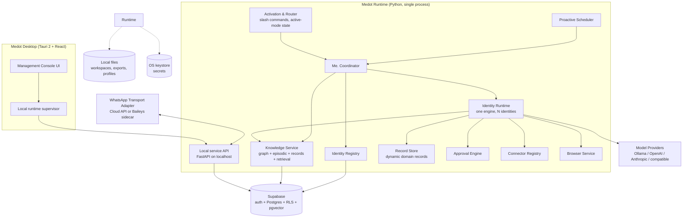
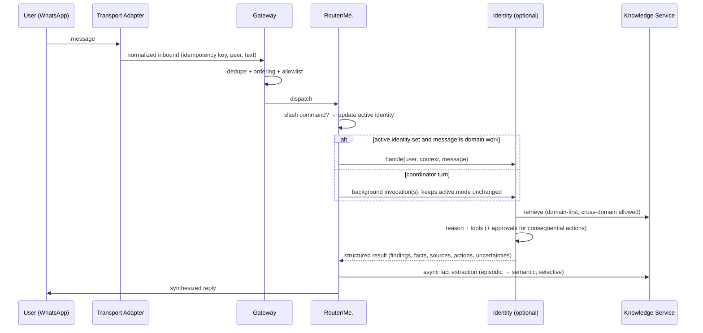

# Medot — System Architecture

Status: **Proposed v1 — pending review** (Stage 1 deliverable)

---

## 1. The three execution concepts (and the one common confusion)

Medot has exactly three kinds of agentic things. Keeping them distinct is the
most important architectural rule in this document.

| Concept | Lifetime | Configured in | Visible to user | Runs where |
|---|---|---|---|---|
| **Me. (coordinator)** | Permanent, one per user | Desktop: identity page for Me. | Always — it *is* Medot | Identity runtime |
| **Specialist identity** | Persistent, many per user, user-created | Desktop: identity pages | Always — listed, editable, activatable | Identity runtime |
| **Task worker** (temporary subagent) | Transient, per task | Code/framework (not user-facing) | Only as activity entries inside the owning identity | Spawned by an identity run |

A task worker may help Health summarize a 40-page PDF; when the task ends, the
worker is gone. Health itself persists with its configuration, memory, and
permissions. The identity registry and knowledge system are **framework-independent
application state** — never LangGraph state, never Deep Agents scratch space.

## 2. Component map



One Python process hosts everything. Identities are rows in Supabase executed
by one engine — never processes, containers, or modules.

## 3. Message flow (the canonical turn)



Delivery guarantees live in the transport layer: dedupe by WhatsApp message
id, ordered processing per chat, retries with backoff, and an offline queue so
inbound messages received while the runtime is down are handled on reconnect.

## 4. Me. coordinator design

Me. is itself executed by the same identity runtime with the same model-profile
mechanism — it is just the identity that owns the *global* knowledge scope and
the coordinator system instructions. It additionally holds the exclusive
abilities to:

- mutate the identity registry (create/activate/deactivate/delete — with user
  confirmation for create/delete),
- invoke other identities,
- read across all domains (subject to the same application-layer permission
  checks; ownership metadata still applies),
- manage user-level settings.

**Stale-memory protection is a coordinator contract** (detailed in
`04-knowledge-graph-architecture.md` §6): when a summary in Me.'s context
references delegated knowledge, Me. treats that summary as a *pointer, not a
fact*, and must fetch from the owning identity (or clearly say it cannot).

## 5. Identity runtime (one engine, N identities)

```python
class IdentityRuntime:
    """Executes any identity defined by registry rows. No per-domain code."""

    async def handle(self, identity: IdentityRef, ctx: TurnContext) -> IdentityResult:
        instructions = await self.registry.instructions(identity)   # versioned
        profile     = await self.registry.model_profile(identity)   # provider/model/params
        grants      = await self.registry.tool_grants(identity)     # tools + connectors
        memory      = await self.knowledge.retrieve(identity, ctx)  # scoped retrieval
        ...
```

- **Generic execution loop** — the existing `BaseAgent` loop (tool-call hops)
  is retained as the seed of this engine and refactored to take all domain
  behavior from the registry, never from code.
- **Framework boundary** — verified against current LangGraph docs (Oct 2026):
  LangGraph 1.x is API-stable; a **subgraph is an execution-scoped construct**
  ("a graph used as a node in another graph") and is explicitly *not* a
  persistent-identity mechanism — per-invocation state only unless a
  checkpointer is attached. Therefore **persistent identity state lives in
  Medot's registry (Supabase), never in LangGraph**; LangGraph contributes:
  `StateGraph` execution, the **SQLite checkpointer** (`langgraph-checkpoint-sqlite`,
  a plain local file — no server) for resume-after-restart, and the dynamic
  **`interrupt()` / `Command(resume=…)`** API for the Approval Engine (the
  static `interrupt_before` breakpoints are deprecated for HITL). Deep Agents
  is beta and dependency-heavy — deferred (see `08-providers-connectors-browser.md`).
- **Temporary workers** are spawned by an identity run with a scope-limited
  toolset and a token budget; they can read the owning identity's domain and
  write only back into that run's result. They never mutate the registry.

## 6. Identity lifecycle

```
suggested ──(user confirms)──> creating ──> active ⇄ deactivated ──(user confirms)──> deleted
   │                              │
   └── Me. proposes, user may     └── seed scope copied = NO;
       reject or defer                domain root REASSIGNED to identity
                                      (ownership metadata), Me. keeps a
                                      summary + pointer
```

- **Creation** (user-initiated via Desktop or via Me. chat with explicit
  confirmation): allocate slug, create identity row + instruction document +
  default model profile, attach the *existing* domain root in the graph (or
  create one for a brand-new domain), record ownership. No data is copied or
  duplicated.
- **Activation** is conversational state (`/slug`), not lifecycle — an
  identity can be invoked in the background without being "active".
- **Deactivation** hides it from commands and stops proactive jobs, keeping
  data and history.
- **Deletion** requires confirmation, archives the domain (facts retain
  historical validity) and revokes grants.

Identity-creation suggestiveness (Part 2.5) is implemented as a
**domain-complexity signal**, not a per-message classifier: when a domain root
accumulates enough distinct entities, records, and recurring sessions, the
coordinator raises a one-time suggestion. Thresholds are heuristics with
hysteresis; never a threshold on raw graph depth.

## 7. Knowledge, records, and retrieval (summary)

The full design is in `04-knowledge-graph-architecture.md`. Summary:

- One unified graph per user; identity-owned **logical domains** via ownership
  metadata (not separate graphs/namespaces), so cross-domain relationships
  survive.
- Hybrid memory: episodic (sources) + semantic graph (temporal facts) +
  structured records (JSONB `domain_records`) + a retrieval pipeline
  (classify → domain select → retrieve → compress → verify freshness).
- Writes are selective: meaningful facts only, with provenance and temporal
  validity; extraction is asynchronous after the canonical record is saved.

## 8. Permissions and approvals

- Every tool/connector grant is per-identity (rows in
  `identity_tool_grants` / `identity_connector_grants`); Me.'s grants are its
  own. No identity inherits another's access.
- Consequential external actions (send email, create calendar event, move
  money, post/send on third parties, browser form submissions with side
  effects) pass through the **Approval Engine**: the run pauses with a
  human-readable proposal, the user approves in WhatsApp ("reply YES to
  send"), the approval is recorded, then execution resumes. Quiet-read
  actions need no approval.
- Audit: every consequential action writes `activity_events` with actor
  (identity/run), tool, arguments digest, approval reference, and outcome.

## 9. Messaging transport (summary)

Full strategy in `03-whatsapp-connection-strategy.md`. **Decided
(2026-11-01): Me. connects exclusively through the official WhatsApp Agent
Platform** — the user links the agent via WhatsApp's Agent Manager and
supplies the API key, stored in the OS keystore. Two prerequisites gate
implementation: provider-side developer access (unverified — no public
onboarding documented) and a Medot relay service (OD-13, first server
component). Requirements fixed regardless: **one** conversational identity,
a replaceable adapter interface, dedupe/order/retry, secure credential
persistence, reconnect on restart, and proactive outbound support (daily
briefs).

## 10. Deployment shape

- **Desktop**: Tauri 2 shell + React console; supervises the Python runtime
  (sidecar) and the WhatsApp sidecar when the Baileys transport is selected.
- **Runtime**: Python process; local HTTP API on `127.0.0.1` (loopback only)
  for the console; outbound HTTPS to Supabase and model providers; WhatsApp
  via the selected transport.
- **No user-installed infrastructure**: no PostgreSQL, Redis, Neo4j, Docker,
  or graph DB on user machines. Supabase is the cloud database; ephemeral
  queueing is in-process with a SQLite spool for offline resilience, not a
  Redis server (replaces the AIA Redis dependency for the MVP).

## 11. What changes vs AIA (structural)

| AIA | Medot |
|---|---|
| `business`/`health` hardcoded packages + DB schemas | Identity **rows** in generic tables; no per-domain schema |
| Router keyword-classifies each message to 1 of 2 agents | Persistent active-identity state + slash commands + background invocation |
| Two Postgres schemas + Redis bus | One Supabase Postgres, RLS-scoped; in-process queueing |
| BaseAgent with own loop, two agent classes | One generic runtime; identities are data |
| Agents own disjoint memory tables | One unified graph per user with owned logical domains |
| Local Docker Compose (Postgres/Redis/agents) | Desktop app + local runtime + Supabase |
| Onboarding wizard writes `.env` | Desktop onboarding; secrets in OS keystore |
